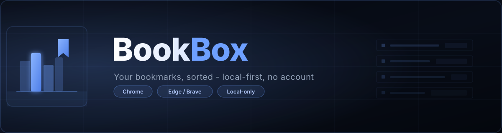

<div align="center">

<picture>
  <source media="(prefers-color-scheme: light)" srcset="docs/assets/banner-light.svg">
  <source media="(prefers-color-scheme: dark)" srcset="docs/assets/banner-dark.svg">
  
</picture>

<br>

[](public/manifest.json)
[](public/manifest.json)
[](#-install-unpacked)
[](https://lvspook.github.io/BookBox/)
[](https://lvspook.github.io/BookBox/privacy.html)

**A bookmark toolbox that opens on your library, not an empty search box.**
Search inside saved pages, sort with proof, and clean up knowing every change is reversible.

[Install](#-install-unpacked) · [Features](#-what-it-does) · [Sorting](#-sorting-with-proof) · [Docs site](https://lvspook.github.io/BookBox/) · [Privacy](https://lvspook.github.io/BookBox/privacy.html) · [AI disclosure](#-ai-assistance-disclosure)

</div>

---

> [!NOTE]
> ## 📦 Not on the Chrome Web Store yet
> BookBox is loaded unpacked from source for now. It works the same in Chrome, Edge and Brave, and takes about a minute to install. See [Install](#-install-unpacked).

---

## ✨ What it does

<table>
<tr>
<td width="50%" valign="top">

**Browse first**
- Search titles, addresses, tags, notes and page text in one box
- Fuzzy matching plus `tag:`, `site:`, `is:unread` operators
- Saved collections and a command palette
- Your library as the home screen

**Clean up safely**
- Duplicates, dead links, redirects and stale saves each get their own section
- Everything goes to a 30-day trash
- Undo toast on every change
- A backup saved before each change

</td>
<td width="50%" valign="top">

**Tag and annotate**
- Nested tags (`frontend/css`)
- Notes, read-later marks and a reader view
- Short local summary per page
- Import/export as HTML, JSON, Markdown, CSV

**Behaviour**
- Right-click any page to save it
- Type `bb` in the address bar to search the library
- Scheduled dead-link checks
- Bot-wall aware (403/429 sites are kept, not deleted)

</td>
</tr>
</table>

## 🧭 Sorting with proof

Smart Local reads real page content and proposes a two-level folder plan. You see
every move before it happens and can untick anything. **Rules always win** over
both local and AI sorting.

## 🤖 Optional AI

Paste a free Gemini, Groq or OpenRouter key to unlock ten extras: AI sorting,
answers with quoted passages and follow-ups, per-page summaries, tag suggestions
from your own vocabulary, duplicate-tag cleanup with a diff, a near-duplicate
tie-breaker, folder renaming, a plain-language reason for stale saves,
tag-and-file on save, and turning a sentence into a rule.

AI controls stay hidden until a key is set, so nothing sits there as a dead
button. With no key, local sorting, local summaries and local answers all still
work. Meaning search needs an embedding model, so it only appears on Gemini.

> Every AI action is optional per feature, and tag-and-file can be switched off
> in Settings.

## 📥 Install (unpacked)

BookBox is not on the Chrome Web Store yet, so you load it directly from the
source. You only need to do this once per browser profile.

### Option A — clone with Git (needed for updates)

```bash
git clone https://github.com/LvSpook/BookBox.git
```

Then:

1. Open `chrome://extensions` (or `edge://extensions` / `brave://extensions`).
2. Turn on **Developer mode** in the top-right corner.
3. Click **Load unpacked**.
4. Select the **`public`** folder inside the cloned repo — not the repo root.

To update later, run `git pull` inside the repo and click the circular
**Reload** arrow on the BookBox card.

### Option B — download a ZIP (no Git)

1. On the GitHub repo page, click **Code → Download ZIP**.
2. Unzip it. Keep the folder somewhere permanent — if you delete it, the
   extension stops loading.
3. Open `chrome://extensions` and turn on **Developer mode**.
4. Click **Load unpacked** and select the **`public`** folder.

Downloading a new ZIP replaces the old one: unzip over the same location
(or unload the old copy first) so you don't end up with two BookBox cards.

### After installing

Pin the BookBox icon from the puzzle-piece menu. On first run a short tour
opens; you can replay it from Settings → **Show me around**. Your bookmarks are
read from the browser itself, so the library fills in immediately.

### Note on the demo page

`public/index.html` is the interactive demo with 23 sample bookmarks. Browsers
block ES modules on `file://`, so opening the file directly from disk shows a
short note instead of the demo. Serve the folder to see it:

```bash
cd public
python -m http.server 8000
# then open http://localhost:8000
```

The demo is a preview only — the real toolbar popup and settings page only
work once the extension is loaded.

## 🗂 Project layout

Everything that ships lives in `public/`. The page you load into the browser is
`public/`, so the repo layout mirrors the extension exactly.

```
public/
  index.html          Interactive preview page (demo bookmarks)
  popup.html          Toolbar popup
  options.html        Full-page settings tab
  boot.js             Entry point for popup.html and options.html
  preview.js          Entry point for index.html
  preview-fallback.js Explains the demo when opened from file://
  app.js              UI state and wiring
  ui.js               Shared markup: tabs, panels, dialogs
  organizer.js        Core engine: duplicates, sorting, search, link checks
  engine-extra.js     Rules, confidence, similarity, collections, export parsers
  search-plus.js      Fuzzy search, operators, match context, grouping
  ai.js               AI provider client, embeddings, token estimate, fallbacks
  ai-features.js      Pure helpers: prompts, parsers, cosine ranking
  data-health.js      Leftover (orphan) detection and removal
  storage.js          Storage keys, quota helpers, sync helpers
  ui-kit.js           Modal, toast, focus trap, formatting helpers
  background.js       Service worker: context menus, omnibox, scheduled checks
docs/                 GitHub Pages site
```

## 🔒 Data and privacy

Everything stays in your browser. Cross-device sync (optional) carries only
settings and tag names. Your API key never leaves the device. Adding a key sends
the bookmarks you sort or ask about to that provider; nothing else leaves the
browser. See [`privacy.html`](https://lvspook.github.io/BookBox/privacy.html) for the full policy.

## 🧪 Tests

Open Settings → Diagnostics → **Run self-check**. It exercises the engine
helpers (URL normalisation, duplicates, HTML import, CSV escaping, leftover
detection) and the AI helpers (vector similarity ranking, tag-merge planning,
citation picking, rule parsing, duplicate-pair selection), then reports storage
health.

## 🏪 Store submission

See [`STORE.md`](STORE.md) for permission justifications, data-disclosure
answers, and the review checklist.

## 🤖 AI assistance disclosure

**Parts of this project were written with the help of an AI coding assistant.**
This is disclosed openly because you deserve to know how the software you install
was made.

- **What this means:** design decisions, code, docs, tests and tooling have been
  produced or reviewed with AI assistance, under human direction and review.
- **What it does not mean:** the project is **not** an official product of any AI
  company, and it is not endorsed by or affiliated with any model provider.
- **Your risk:** AI-assisted code can contain mistakes a human would not have
  made. The self-check and manual testing reduce that risk but cannot eliminate
  it.

If AI-assisted code is a problem for your use case, please don't install it — no
hard feelings.

---

<div align="center">
<sub>Chrome · Edge · Brave — local-first — your data stays in your browser</sub>
</div>
